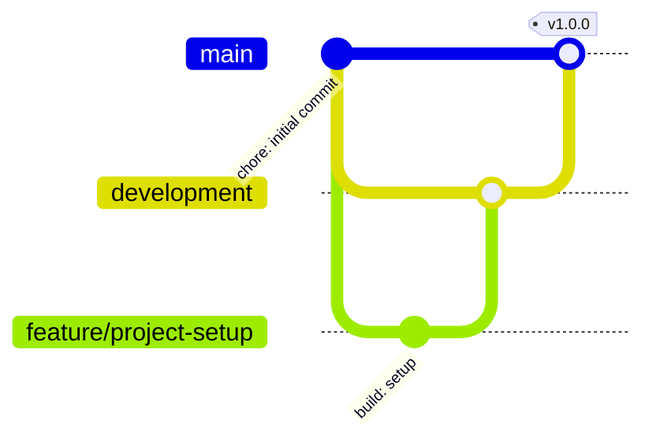

# Estrategia de Git

Se usa una variante de **GitHub Flow** con una rama de integración intermedia.

## Ramas

| Rama | Propósito | Reglas |
|---|---|---|
| `main` | Versión estable y entregable. Cada release (`v1.0.0`) se etiqueta aquí. | Solo recibe merges desde `development` vía Pull Request. |
| `development` | Integración de las funcionalidades terminadas. | Recibe merges desde `feature/*` vía Pull Request. |
| `feature/<descripcion>` | Una rama por fase o funcionalidad (por ejemplo, `feature/project-setup`, `feature/eda-preprocessing`). | Se crea desde `development` y se elimina tras el merge. |

## Flujo

1. Crear la rama desde `development`: `git checkout development && git pull && git checkout -b feature/<descripcion>`.
2. Hacer commits pequeños y descriptivos.
3. Abrir un Pull Request `feature/*` → `development` con descripción de los cambios y validar que los notebooks corren.
4. Al cerrar un hito, abrir un Pull Request `development` → `main` (merge commit) y etiquetar el release.

## Convención de commits

Se usa [Conventional Commits](https://www.conventionalcommits.org/es/v1.0.0/): `<tipo>(<alcance opcional>): <descripción en inglés>`.

| Tipo | Uso |
|---|---|
| `feat` | Nueva funcionalidad (features, modelos, app) |
| `fix` | Corrección de errores |
| `docs` | Documentación (README, notebooks narrativos) |
| `build` | Dependencias y entorno (`pyproject.toml`, `uv.lock`) |
| `chore` | Mantenimiento sin impacto funcional |
| `refactor` | Cambios de código sin cambio de comportamiento |
| `test` | Pruebas |

## Versionado

[Semantic Versioning](https://semver.org/lang/es/): el entregable del curso se publica como release `v1.0.0` sobre `main`.
