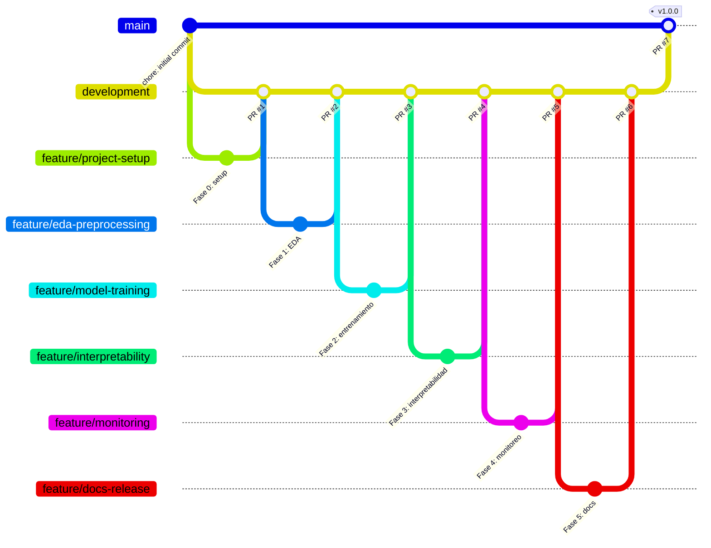

# Estrategia de Git

Se usa una variante de **GitHub Flow** con una rama de integración intermedia.

## Ramas

| Rama | Propósito | Reglas |
|---|---|---|
| `main` | Versión estable y entregable. Cada release (`v1.0.0`) se etiqueta aquí. | Solo recibe merges desde `development` vía Pull Request. |
| `development` | Integración de las funcionalidades terminadas. | Recibe merges desde `feature/*` vía Pull Request. |
| `feature/<descripcion>` | Una rama por fase o funcionalidad (por ejemplo, `feature/project-setup`, `feature/eda-preprocessing`). | Se crea desde `development` y se elimina tras el merge. |

## Flujo

1. Crear la rama desde `development`: `git checkout development && git pull && git checkout -b feature/<descripcion>`.
2. Hacer commits pequeños y descriptivos.
3. Abrir un Pull Request `feature/*` → `development` con descripción de los cambios y evidencia de verificación
   (notebook ejecutado sin errores, `ruff` limpio).
4. Mergear con **merge commit** (`git merge --no-ff`, botón *Create a merge commit*) para conservar la historia de
   cada fase.
5. Al cerrar el proyecto, abrir un Pull Request `development` → `main`, mergear y etiquetar el release.

Cuando una fase dependía de otra aún no mergeada, la rama se creó encima de la anterior (*stacked branch*) y el PR
lo indica en su descripción; se mergearon en orden.

## Pull Requests del proyecto

| PR | Rama → base | Contenido |
|---|---|---|
| [#1](https://github.com/richardmk/Project-MLEngineer3/pull/1) | `feature/project-setup` → `development` | Fase 0: entorno `uv`, estructura, MLflow → DagsHub |
| [#2](https://github.com/richardmk/Project-MLEngineer3/pull/2) | `feature/eda-preprocessing` → `development` | Fase 1: ingesta, EDA, features, split temporal |
| [#3](https://github.com/richardmk/Project-MLEngineer3/pull/3) | `feature/model-training` → `development` | Fase 2: Optuna vs Random Search, AutoML, registro del campeón |
| [#4](https://github.com/richardmk/Project-MLEngineer3/pull/4) | `feature/interpretability` → `development` | Fase 3: SHAP, permutación, PDP/ICE, LIME |
| [#5](https://github.com/richardmk/Project-MLEngineer3/pull/5) | `feature/monitoring` → `development` | Fase 4: Evidently por día y app Streamlit |
| #6 | `feature/docs-release` → `development` | Fase 5: README, Model Card, report HTML |
| #7 | `development` → `main` | Release v1.0.0 |

## Convención de commits

Se usa [Conventional Commits](https://www.conventionalcommits.org/es/v1.0.0/): `<tipo>(<alcance opcional>): <descripción en inglés>`.

| Tipo | Uso |
|---|---|
| `feat` | Nueva funcionalidad (features, modelos, app) |
| `fix` | Corrección de errores |
| `docs` | Documentación (README, notebooks narrativos) |
| `build` | Dependencias y entorno (`pyproject.toml`, `uv.lock`) |
| `chore` | Mantenimiento sin impacto funcional |
| `refactor` | Cambios de código sin cambio de comportamiento |
| `test` | Pruebas |

## Versionado

[Semantic Versioning](https://semver.org/lang/es/): el entregable del curso se publica como release `v1.0.0` sobre `main`.
