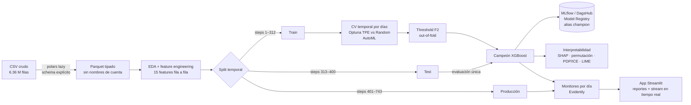
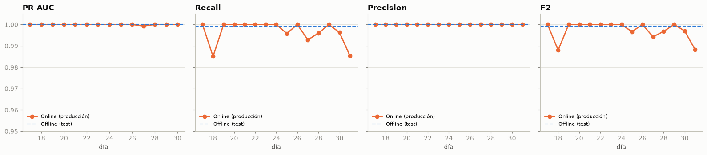
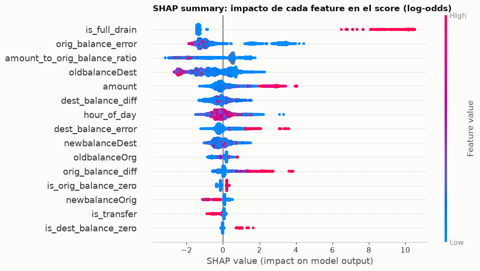
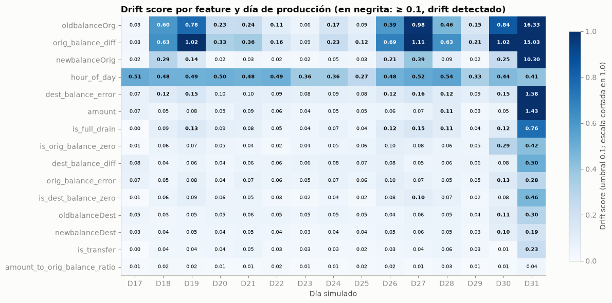

# Detección de fraude en transacciones móviles (PaySim)

Proyecto final del **Curso III de la Especialización en Machine Learning Engineering**: entrenamiento con
optimización de hiperparámetros, tracking de experimentos, interpretabilidad y monitoreo en producción de un modelo
de detección de fraude.

| Recurso | Enlace |
|---|---|
| Experimentos MLflow (DagsHub) | <https://dagshub.com/richardmk/ProjectMLEngineer3/experiments> |
| UI de MLflow / Model Registry | <https://dagshub.com/richardmk/ProjectMLEngineer3.mlflow> |
| Modelo productivo | `paysim-fraud-detector` **v2**, alias `champion` |
| Report HTML | [`reports/report.html`](reports/report.html) |
| App de monitoreo | `uv run streamlit run app/app.py` |

## Contenido

1. [Problema de ML y flujo del proyecto](#1-problema-de-ml-y-flujo-del-proyecto)
2. [Dataset y diccionario de datos](#2-dataset-y-diccionario-de-datos)
3. [Técnicas de optimización de hiperparámetros](#3-técnicas-de-optimización-de-hiperparámetros)
4. [Model Card](#4-model-card)
5. [Resultados: métricas offline y online](#5-resultados-métricas-offline-y-online)
6. [Interpretabilidad local y global](#6-interpretabilidad-local-y-global)
7. [Monitoreo](#7-monitoreo)
8. [Conclusiones](#8-conclusiones)
9. [Estructura del repositorio y ejecución](#9-estructura-del-repositorio-y-ejecución)
10. [Estrategia de Git y release](#10-estrategia-de-git-y-release)

---

## 1. Problema de ML y flujo del proyecto

- **Tipo:** aprendizaje **supervisado**, **clasificación binaria**.
- **Target:** `isFraud`. Una transacción es fraude si la ejecuta un agente que tomó el control de una cuenta para
  vaciarla mediante transferencias y luego retirar el dinero.
- **Objetivo de negocio:** marcar las transacciones fraudulentas apenas se registran, para bloquear el retiro
  (`CASH_OUT`) que sigue a la transferencia, con el menor número posible de falsas alarmas.
- **Restricción temporal del curso:** `step ≤ 400` es data de referencia/entrenamiento; `step ≥ 401` es data de
  **producción**, usada solo para monitoreo y métricas online.
- **Desbalance extremo:** 0.129 % de fraude. La métrica principal es **PR-AUC**, con recall, precision, F1, F2 y
  matriz de confusión. Accuracy no se usa: un modelo que nunca predice fraude tendría 99.87 %.



| Fase | Notebook | Qué hace |
|---|---|---|
| 1 | [`01_preprocesamiento.ipynb`](notebooks/01_preprocesamiento.ipynb) | Ingesta a Parquet, EDA, features, split temporal, muestras versionadas |
| 2 | [`02_entrenamiento.ipynb`](notebooks/02_entrenamiento.ipynb) | Sanity checks, baselines, Optuna vs Random Search, AutoML, threshold, registro del campeón |
| 3 | [`03_interpretabilidad.ipynb`](notebooks/03_interpretabilidad.ipynb) | SHAP, permutation importance, PDP/ICE, SHAP waterfall y LIME por caso |
| 4 | [`04_monitoreo.ipynb`](notebooks/04_monitoreo.ipynb) | Data, prediction, concept y model drift por día; métricas online vs offline |

---

## 2. Dataset y diccionario de datos

**PaySim** simula 30 días de transacciones de dinero móvil (1 `step` = 1 hora, 743 steps con datos), a partir de
logs reales de un servicio africano de dinero móvil. Fuente:
[Kaggle · Synthetic Financial Datasets For Fraud Detection](https://www.kaggle.com/datasets/ealaxi/paysim1).

| Columna | Tipo | Descripción |
|---|---|---|
| `step` | int | Unidad de tiempo (1 step = 1 hora) |
| `type` | categórica | `CASH_IN`, `CASH_OUT`, `DEBIT`, `PAYMENT`, `TRANSFER` |
| `amount` | float | Monto de la transacción en moneda local |
| `nameOrig` | id | Cliente que inicia la transacción (**no se usa como feature**) |
| `oldbalanceOrg` / `newbalanceOrig` | float | Saldo del origen antes y después |
| `nameDest` | id | Destinatario (**no se usa como feature**; solo el flag merchant) |
| `oldbalanceDest` / `newbalanceDest` | float | Saldo del destino antes y después (sin información para merchants `M…`) |
| `isFraud` | 0/1 | **Target** |
| `isFlaggedFraud` | 0/1 | Regla de negocio: intentos de transferir > 200,000 (**excluida**, ver abajo) |

**Hallazgos del EDA**

| Hecho | Valor | Decisión |
|---|---|---|
| Tasa de fraude | 0.129 % (8,213 de 6.36 M) | Métricas para desbalance; threshold optimizado |
| Fraude por tipo | Solo `TRANSFER` (0.77 %) y `CASH_OUT` (0.18 %) | **Alcance del modelo:** esos dos tipos (2.77 M filas); el resto, score 0 por regla |
| Merchants | Solo reciben `PAYMENT`, sin fraude | `is_merchant_dest` es constante en el alcance → fuera del modelo |
| `isFlaggedFraud` | 16 marcas, todas fraude; 409 K transferencias > 200 K sin marcar | **Excluida** (no sigue su regla, sospecha de leakage); se usa como baseline |
| Vaciado total (`amount ≈ oldbalanceOrg`) | 97.6 % de los fraudes vs ~0 % de los legítimos | Feature `is_full_drain`: **la señal dominante** |
| Hora del día | Fraude ~constante (~11/hora); el volumen legítimo es cíclico | `hour_of_day = (step−1) % 24`; `step` crudo no se usa |
| Producción | Tasa de fraude 1.55 % (~10× la de train) | Prior shift: clave para el monitoreo |

**Features (15, fila a fila, sin `fit`, así que no hay leakage entre splits):** los 5 montos y saldos crudos,
`orig_balance_diff`, `orig_balance_error`, `dest_balance_diff`, `dest_balance_error`,
`amount_to_orig_balance_ratio`, `is_orig_balance_zero`, `is_full_drain`, `is_dest_balance_zero`, `hour_of_day` e
`is_transfer`. Ver [`src/fraud_detection/features.py`](src/fraud_detection/features.py).

**Split temporal**

| Conjunto | Steps | Filas | Fraudes | Tasa |
|---|---|---|---|---|
| Train | 1–312 (13 días completos) | 1,918,423 | 3,521 | 0.18 % |
| Test | 313–400 | 611,113 | 956 | 0.16 % |
| Producción | 401–743 | 240,873 | 3,736 | 1.55 % |

---

## 3. Técnicas de optimización de hiperparámetros

- **Validación:** 4 folds *expanding window* por **días completos** dentro de train. Cada fold valida un día y
  entrena con todos los anteriores, sin split aleatorio.
- **Submuestreo de legítimos** (se conserva 10 %) **solo en los folds de entrenamiento**: acelera ~10× el tuning; la
  validación y el test mantienen la proporción real.
- **Optuna TPE** (bayesiano multivariado) **+ MedianPruner**: poda un trial si tras un fold su PR-AUC acumulado
  queda bajo la mediana de los trials previos.
- **Random Search** con el mismo espacio y presupuesto, como baseline de optimización.
- **AutoML (Reto ML 1):** un estudio TPE donde **el algoritmo es un hiperparámetro** con sub-espacios condicionales.
- **Threshold:** maximiza **F2** (el recall pesa 2×) sobre las predicciones *out-of-fold*. Se elige el **punto
  medio** del intervalo óptimo para tener margen ante el drift, y se contrasta con una curva de costo de negocio.

| Estudio | Mejor CV PR-AUC | Trials | Podados | Cómputo |
|---|---|---|---|---|
| Logistic Regression · TPE | 0.9981 | 10 | 1 | 103 s |
| Random Forest · TPE | 0.9989 | 5 | 0 | 311 s |
| XGBoost · TPE | 0.9990 | 15 | 6 | **182 s** |
| XGBoost · Random | 0.9990 | 15 | 0 | 229 s |
| LightGBM · TPE | 0.9989 | 15 | 3 | 276 s |
| LightGBM · Random | 0.9989 | 15 | 0 | 220 s |
| **AutoML · TPE** | **0.9991** (XGBoost) | 25 | 10 | 227 s |

**Lectura:** el objetivo está saturado (todos los algoritmos rinden 0.998–0.999), así que TPE y Random Search llegan
al mismo valor. La ventaja medible de TPE con poda es la **eficiencia**: en XGBoost usó 21 % menos cómputo. AutoML
asignó 17 de sus 25 trials a XGBoost y confirmó al ganador de forma independiente.

**Sanity checks (por qué el PR-AUC es casi 1):**

| Experimento (LightGBM de referencia, CV) | PR-AUC |
|---|---|
| Labels barajados (test de leakage) | **0.0019** (azar = 0.0018) |
| Regla `isFlaggedFraud` | 0.0034 |
| Regla `is_full_drain` sola | 0.975 |
| Solo información previa a la transacción | 0.984 |
| Modelo con las 15 features | 0.9988 |

No hay leakage: el pipeline no filtra el target. La separación casi perfecta es una **propiedad del simulador**,
porque el agente fraudulento vacía la cuenta.

---

## 4. Model Card

Formato basado en [Model Cards (Mitchell et al.)](https://www.kaggle.com/code/var0101/model-cards).

| Sección | Contenido |
|---|---|
| **Detalles del modelo** | XGBoost (`XGBClassifier`, `tree_method=hist`): 150 árboles, profundidad 3, learning rate 0.160, `min_child_weight` 1.20, `subsample` 0.854, `colsample_bytree` 0.790, `reg_lambda` 0.004, `scale_pos_weight` 1.91. Entrenado con el 10 % de los legítimos y todos los fraudes de train. **Threshold 0.828.** Registrado como `paysim-fraud-detector` v2 (alias `champion`) en DagsHub. Versión 1.0.0, octubre 2026. |
| **Uso previsto** | Puntuar transacciones `TRANSFER` y `CASH_OUT` **inmediatamente después de registrarse** en el ledger, para bloquear el retiro siguiente o enviar a revisión. Los demás tipos reciben score 0 por regla. |
| **Usos fuera de alcance** | Datos reales de un banco sin reentrenar ni validar; scoring *antes* de ejecutar la transacción (usa saldos posteriores); decisiones automáticas sin revisión humana sobre clientes reales. |
| **Datos de entrenamiento** | PaySim, steps 1–312: 1.92 M transacciones TRANSFER/CASH_OUT, 3,521 fraudes. Sin identificadores de cuenta. |
| **Datos de evaluación** | Offline: steps 313–400 (611 K transacciones, 956 fraudes), evaluación única. Online: steps 401–743 (241 K, 3,736 fraudes). |
| **Métricas** | PR-AUC (principal), recall, precision, F1, F2, matriz de confusión; ROC-AUC como complemento. Threshold por F2 sobre predicciones out-of-fold. |
| **Resultados** | Test: PR-AUC 0.99999, recall 99.9 %, precision 100 %, 0 falsos positivos, 1 fraude no detectado. Producción: recall 99.65 %, precision 100 %. |
| **Factores** | El desempeño depende de que el fraude siga el patrón "vaciar la cuenta" (97 % de los casos). Los fraudes topeados en 10 M y los registros con monto 0 son los casos frontera. |
| **Consideraciones éticas** | Datos sintéticos, sin información personal. En un despliegue real, una falsa alarma bloquea dinero de un cliente legítimo: se recomienda revisión humana y un canal de apelación. |
| **Limitaciones y recomendaciones** | El PR-AUC ≈ 1 **no es extrapolable a datos reales**: refleja un patrón determinista del simulador. Dependencia fuerte de una sola relación (monto ↔ saldo del origen): si el fraude cambia de táctica, el modelo se degradará rápido. Monitorear el % de fraudes que vacían la cuenta como alerta temprana (sección 7). |

---

## 5. Resultados: métricas offline y online

**Offline: test (steps 313–400), evaluación única con el threshold fijado en CV**

| Modelo | PR-AUC | ROC-AUC | Precision | Recall | F1 | F2 | FP | FN |
|---|---|---|---|---|---|---|---|---|
| **XGBoost (campeón)** | **0.99999** | 1.0000 | **1.000** | **0.999** | 0.9995 | 0.9992 | **0** | **1** |
| Regla `is_full_drain` | 0.9833 | 0.9916 | 1.000 | 0.983 | 0.9916 | 0.9866 | 0 | 16 |
| Regla `isFlaggedFraud` | 0.0026 | 0.5005 | 1.000 | 0.001 | 0.0021 | 0.0013 | 0 | 955 |
| XGBoost (CV out-of-fold) | 0.9990 | 1.0000 | 1.000 | 0.996 | 0.9982 | 0.9970 | 0 | 4 |

El modelo detecta **15 fraudes más que la regla** sin agregar falsas alarmas, y la CV y el test son consistentes.

**Online: producción (steps 401–743), por día y en total**

| Métrica | Offline (test) | Online (total) | Online (peor día) |
|---|---|---|---|
| Precision | 1.000 | **1.000** | 1.000 |
| Recall | 0.999 | **0.9965** (3,723 / 3,736) | 0.985 (días 18 y 31) |
| F2 | 0.9992 | **0.9972** | 0.988 |



---

## 6. Interpretabilidad local y global

**Global**

| Técnica | Resultado |
|---|---|
| SHAP (media \|SHAP\|) | 1.º `is_full_drain` (2.64), 2.º `orig_balance_error` (1.46), 3.º `amount_to_orig_balance_ratio`, 4.º `oldbalanceDest` |
| Permutation importance | Permutar `is_full_drain` resta **0.45** de PR-AUC; el resto ≤ 0.0015 (son redundantes entre sí) |
| PDP / ICE | `is_full_drain`: P(fraude) de 0.06 → 0.78. Las curvas ICE caen a 0 cuando el error del origen es > ~1,000 o el destino tiene > ~100 K |



**Local** (SHAP waterfall + LIME):

| Caso | Score | Explicación |
|---|---|---|
| Fraude típico | 1.000 | CASH_OUT que vacía la cuenta: `is_full_drain` +10.3 log-odds |
| Fraude que la regla no ve | 0.9999 | TRANSFER topeado en **10 M** hacia un destino que no registra el dinero: monto, error de saldo en el destino y hora (1 a. m.) |
| Fraude no detectado | 0.257 | CASH_OUT de **monto 0**: no movió dinero, así que no hay pérdida |
| Legítimo más sospechoso | 0.522 | TRANSFER de 1.99 M a un destino vacío, frenado porque el origen no cuadra y no hay vaciado |

**SHAP vs LIME:** con un modelo tan seguro (probabilidades casi siempre 0 o 1), el sustituto lineal de LIME tiene
R² ≤ 0.13. SHAP, exacto para árboles, es la explicación local confiable.

**Conclusión de negocio:** el modelo aprendió la lógica del agente fraudulento: vaciar la cuenta (o mover el tope de
10 M) hacia una cuenta mula vacía, de preferencia de madrugada. Coincide con los patrones esperados, con un matiz: en
PaySim el saldo del origen de los fraudes **sí** cuadra; son los legítimos los que no.

---

## 7. Monitoreo

Referencia: muestra de 100 K transacciones de steps ≤ 400. Producción dividida en **15 periodos de 1 día**
(24 steps). Por periodo se genera un reporte **Evidently 0.7** (drift de features, del score, del target y
clasificación), guardado en [`reports/evidently/`](reports/evidently/).

| Tipo de drift | ¿Hay? | Evidencia |
|---|---|---|
| **Data drift** | Sí, fuerte | Saldos del origen con drift en 80–87 % de los días; `hour_of_day` todos los días |
| **Prediction drift** | Sí | El score cambia, pero la tasa de alertas (1.55 %) sigue exactamente a la tasa real de fraude |
| **Concept drift** | No | P(fraude \| vaciado total) = 1.0 todos los días; 97.2 % de los fraudes vacían la cuenta (referencia 98.7 %) |
| **Model drift** | No | Precision 1.0 todos los días; recall diario 98.5–100 % |



- El **día 31 tiene solo fraudes** (272): la simulación deja de generar tráfico legítimo al final.
- **Lección:** el drift fue fuerte y el desempeño no se degradó. Alertar solo por drift habría generado falsas
  alarmas, así que la política de alertas combina métricas online e indicadores de concepto (ver notebook 04).

**App de monitoreo (Streamlit):** sidebar con selector de periodo; pestañas **Resumen** (KPIs y métricas online vs
offline), **Reporte Evidently** (el reporte del periodo), **Drift por feature** (heatmap y detalle) y **Tiempo real**
(**Reto ML 2**: simula la llegada de transacciones hora a hora y recalcula las métricas en cada paso; si existe
`models/champion.joblib`, puntúa en vivo con el modelo).

```bash
uv run streamlit run app/app.py   # http://localhost:8501
```

---

## 8. Conclusiones

1. **El fraude de PaySim es casi determinista:** el 97.6 % de los fraudes vacía la cuenta. Una regla simple
   (`is_full_drain`) logra recall 98.3 % con precision 100 %. Se validó explícitamente que el PR-AUC ≈ 1 **no es
   leakage** (labels barajados → azar).
2. **El modelo agrega valor sobre la regla** en los casos frontera (montos topeados en 10 M, destinos que no registran
   el dinero): 15 fraudes más detectados en test, sin falsas alarmas.
3. **La optimización está saturada:** TPE, Random Search y AutoML llegan al mismo PR-AUC. La poda de Optuna ahorró
   hasta 21 % de cómputo, y AutoML confirmó XGBoost de forma independiente.
4. **Robusto en producción:** con un prior shift de ~10× y drift fuerte en saldos y horario, el recall online
   (99.65 %) y la precision (100 %) se mantienen. El concepto no cambió.
5. **Riesgo principal:** la dependencia de una sola relación. El indicador a vigilar es el **% de fraudes que vacían
   la cuenta**, que en los días con menor valor anticipó las caídas de recall.
6. **Siguientes pasos para un entorno real:** labels con retraso (monitorear proxies sin label), features de
   historial por cuenta calculadas *point-in-time*, y reentrenamiento disparado por las alertas de concepto.

---

## 9. Estructura del repositorio y ejecución

```
.
├── app/app.py                 # App de monitoreo (Streamlit + Evidently)
├── data/
│   ├── raw/                   # CSV original (ignorado por git)
│   ├── processed/             # Parquet intermedios (ignorado)
│   ├── reference.csv          # Muestra de referencia (100 K, steps ≤ 400)
│   ├── production.csv         # Producción del alcance del modelo (steps ≥ 401)
│   └── *_scored.csv           # Los mismos datos con el score del campeón (para la app)
├── models/                    # Copia local del campeón (ignorado; el oficial está en DagsHub)
├── notebooks/01..04_*.ipynb   # Preprocesamiento, entrenamiento, interpretabilidad, monitoreo
├── reports/
│   ├── report.html            # Report HTML final
│   ├── figures/               # Figuras clave usadas en el README
│   ├── optimization/          # Resultados de estudios, candidatos y test (CSV)
│   └── evidently/             # Snapshots Evidently por día + HTML de toda la producción
├── scripts/                   # Generadores de notebooks, report, chequeo de MLflow
├── src/fraud_detection/       # config, data, features, split, train, evaluate, interpret, monitoring, tracking
├── GIT_STRATEGY.md · CLAUDE.md · pyproject.toml · uv.lock · requirements.txt
```

**Ejecución**

```bash
# 1. Entorno (Python 3.12 + uv)
uv sync                                    # o: pip install -r requirements.txt

# 2. Datos: ver scripts/download_data.md → data/raw/PS_20174392719_1491204439457_log.csv

# 3. Credenciales de DagsHub (solo para notebooks 02–04)
cp .env.example .env                       # completar URI, usuario y token
uv run python scripts/check_mlflow.py

# 4. Notebooks, en orden
uv run jupyter nbconvert --to notebook --execute --inplace --ExecutePreprocessor.timeout=-1 notebooks/01_preprocesamiento.ipynb   # ~30 s
uv run jupyter nbconvert --to notebook --execute --inplace --ExecutePreprocessor.timeout=-1 notebooks/02_entrenamiento.ipynb      # ~36 min
uv run jupyter nbconvert --to notebook --execute --inplace --ExecutePreprocessor.timeout=-1 notebooks/03_interpretabilidad.ipynb  # ~1 min
uv run jupyter nbconvert --to notebook --execute --inplace --ExecutePreprocessor.timeout=-1 notebooks/04_monitoreo.ipynb          # ~2 min

# 5. Report HTML y app
uv run python scripts/build_report.py
uv run streamlit run app/app.py
```

La app y el report funcionan desde un clon limpio, sin el CSV crudo ni el modelo local: usan los datos y snapshots
versionados. Pico de RAM medido: ~1.5 GB.

---

## 10. Estrategia de Git y release

GitHub Flow con rama de integración: `feature/*` → `development` → `main`, Conventional Commits y una Pull
Request por fase. Detalle en [`GIT_STRATEGY.md`](GIT_STRATEGY.md). El entregable es el release
**[v1.0.0](https://github.com/richardmk/Project-MLEngineer3/releases/tag/v1.0.0)**.
